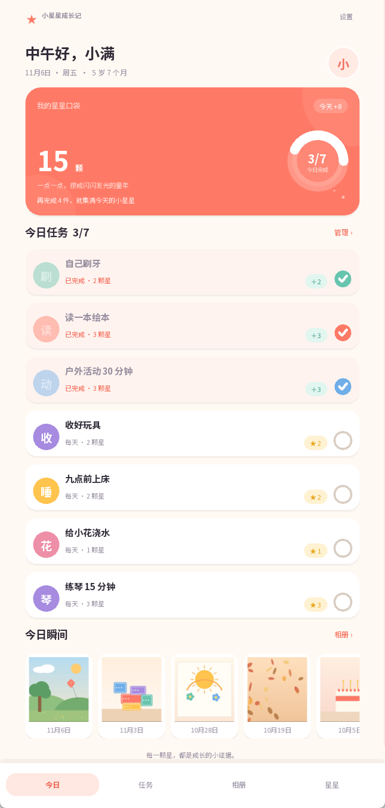
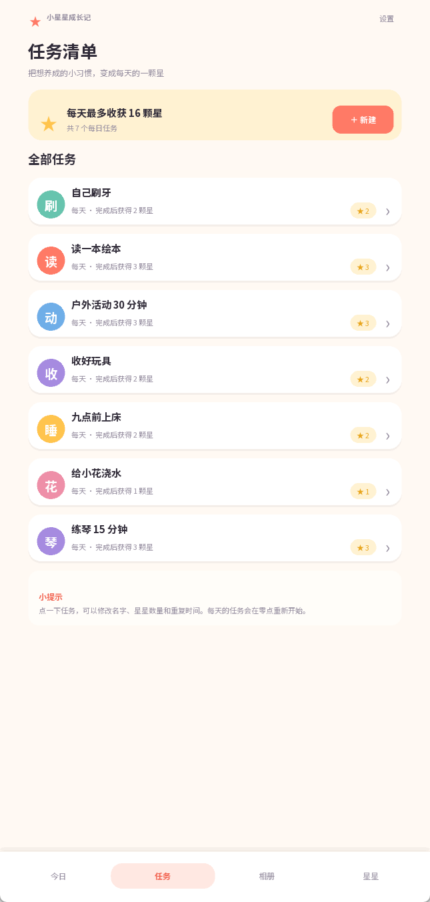
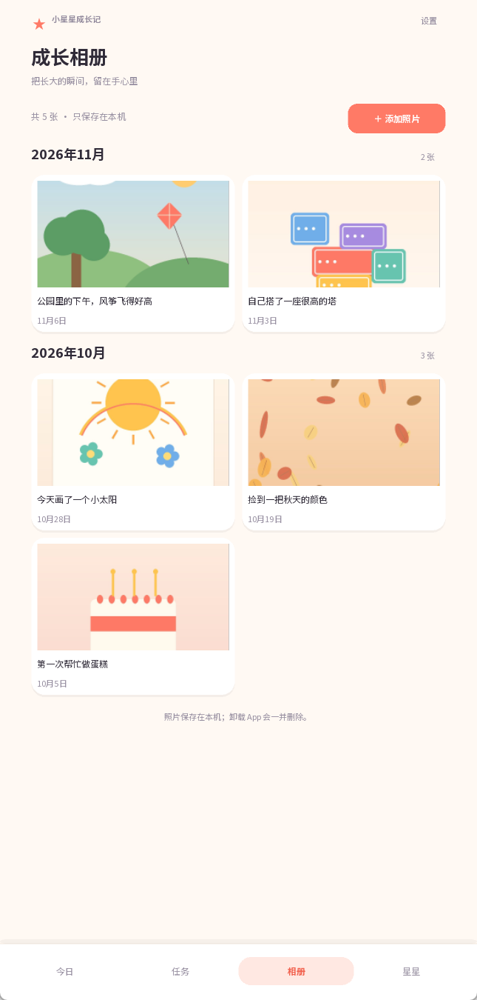
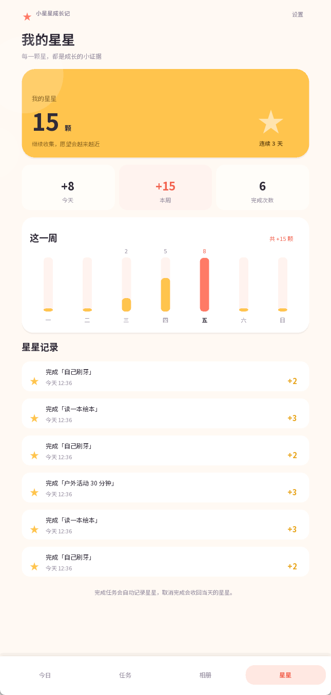
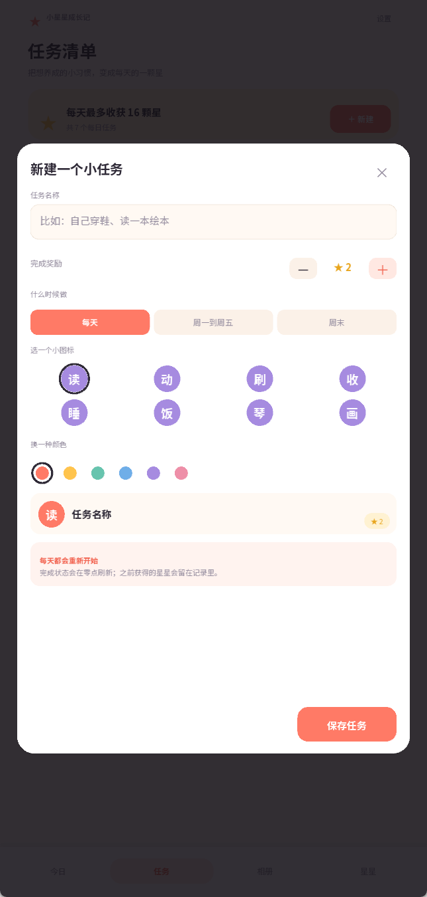
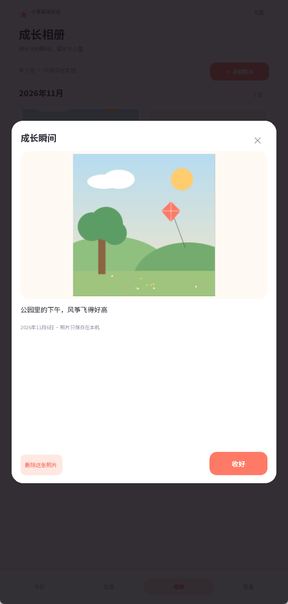

# 小星星成长记

一个用 **Python + Kivy + SQLite** 写的儿童成长记录 App：每天的小任务、完成后的星星积分、以及一本只属于家人的成长相册。

> 完全离线：没有账号、没有云端、没有网络权限。任务、积分和照片都只写入当前设备。

| 今日 | 任务清单 |
| --- | --- |
|  |  |

| 成长相册 | 我的星星 |
| --- | --- |
|  |  |

| 新建任务 | 查看照片 |
| --- | --- |
|  |  |

## 功能

- **今日**：问候语、宝贝年龄、总星星、今日完成进度环；每天的任务一目了然，点一下就能完成或取消。
- **任务设定**：新建、编辑、删除任务；积分 1–10 颗；支持「每天 / 周一到周五 / 周末」三种重复方式；10 个手写风图标、6 种颜色。
- **照片上传**：从手机系统相册选择照片，自动复制、纠正方向并生成缩略图；按月份分组浏览；可以查看大图和删除。
- **积分**：总积分、今日/本周/累计完成、7 天小柱状图、完整的星星流水。
- **宝贝资料**：昵称和生日，自动计算「5 岁 7 个月」这样的年龄；可以清空全部记录重新开始。
- **实时更新**：完成任务的同一瞬间，首页进度、积分余额、星星记录全部刷新；零点自动切换到新一天。
- **数据只在本机**：Android 端关闭了系统云备份，也没有申请 `INTERNET` 权限。

## 直接运行（Windows 桌面预览）

**双击 [`run.bat`](run.bat) 即可。** 当前目录已经带好 `.venv`（Python 3.13 + Kivy），正常情况下会直接弹出 App 窗口。

> 注意：这里是 **Python 源码 + Windows 桌面预览**，不是 Android 安装包。手机不能直接双击 `.py` 文件运行，手机版需要先按下面的步骤打包 APK。

如果 `.venv` 被删除或复制到另一台电脑，`run.bat` 会尝试用随项目附带的 `.python313` 自动重建环境；如果连 `.python313` 也没有，则需要先安装 Python 3.13：

```bat
py -3.13 -m venv .venv
.venv\Scripts\pip install -r requirements.txt
.venv\Scripts\python main.py
```

仍然打不开时，在项目文件夹的地址栏输入 `cmd` 回车，然后运行：

```bat
run.bat
```

这样能看到具体错误，不会一闪而过。Kivy 的详细日志在 `%USERPROFILE%\.kivy\logs\`。

桌面端用 Tk 文件选择框挑照片；界面固定在手机竖屏比例，方便预览。

## 构建 Android APK

Kivy 的 Android 打包工具 Buildozer 只能在 **Linux 或 macOS** 上运行。Windows 用户推荐用 **WSL2 + Ubuntu**：

```bash
sudo apt update
sudo apt install -y git zip unzip openjdk-17-jdk python3-pip python3-venv \
    autoconf libtool pkg-config zlib1g-dev libncurses5-dev libncursesw5-dev \
    libtinfo6 cmake libffi-dev libssl-dev

cd ~
python3 -m venv .buildenv
source .buildenv/bin/activate
pip install --upgrade pip buildozer cython


# 把项目复制到 Linux 文件系统（不要放在 /mnt/c，构建会非常慢）
cd ~/stargrowth
buildozer -v android debug
```

第一次构建会下载 Android SDK/NDK，通常需要 20–40 分钟。生成的 APK 位于：

```text
bin/stargrowth-1.0.0-arm64-v8a_armeabi-v7a-debug.apk
```

连接手机并打开 USB 调试后：

```bash
adb install -r bin/stargrowth-1.0.0-arm64-v8a_armeabi-v7a-debug.apk
```

也可以把项目推到 GitHub，在 **Actions → Build Android APK** 中手动运行工作流，构建完成后下载 artifact。

> Debug APK 适合家庭自用。如果要上架应用商店，需要自己配置 release keystore，并把 `android.release_artifact` 改为 `aab`。

## 数据保存在哪里

| 平台 | 位置 |
| --- | --- |
| Windows | `%APPDATA%\stargrowth\` |
| Android | App 私有目录 `files/` 下（`com.family.stargrowth`） |

目录里有：

```text
growth.db        SQLite 数据库：资料、任务、完成记录、积分流水、照片索引
photos/          原始照片副本（导入时已纠正方向）
thumbs/          相册网格用缩略图
```

照片导入后就不再依赖系统相册里的原文件；即使原图被删除，App 内仍然可以查看。

## 为什么能实时更新

所有页面共享同一个 `AppState`。任何写操作（完成任务、加照片、改资料）都按下面的顺序执行：

```text
界面操作 -> AppState -> SQLite 落盘 -> state.refresh() -> dispatch('on_change')
```

四个页面都监听 `on_change`；当前页立即重建，后台页标记为 dirty，切回来时再重建。没有轮询、没有网络请求，所以是真正的本地即时更新。

每天零点前后，`GrowthApp` 的定时检查发现日期变化后会刷新状态，任务完成情况自动回到新的一天；App 从后台回到前台时也会刷新。

## 项目结构

```text
main.py                    启动入口（窗口尺寸、DPI、Kivy 配置）
buildozer.spec             Android 打包配置
star_growth/
  app.py                   App、页面导航、弹窗、Toast、生命周期
  state.py                 单一状态源，所有派生数据和实时通知
  repository.py            SQLite、积分账本、照片复制与缩略图
  photo.py                 Android 相册选择（content:// 复制到 cache）/ 桌面文件框
  theme.py                 颜色、字号、间距
  fonts.py                 注册内置 Noto Sans SC
  screens/                 今日、任务、相册、星星四个页面
  ui/widgets.py            圆角卡片、进度环、任务行、周柱状图等
  ui/modals.py             任务编辑、照片编辑/查看、资料、确认弹窗
assets/
  icon.png / presplash.png
  fonts/                   Noto Sans SC Regular/Bold（SIL OFL 1.1）
tests/test_repository.py   数据层测试
tools/                     演示数据、截图、构建辅助脚本
```

## 开发与测试

```bash
pip install -r requirements-dev.txt
python -m pytest -q
python -m pyflakes main.py star_growth tests tools
```

生成一套演示数据（会重置 `demo_data/`，只用于截图和手动检查）：

```bash
python tools/seed_demo.py
```

## 已知限制

- **iOS 不支持**：Kivy 的 iOS 打包链路和本项目的相册选择实现没有覆盖 iOS。
- **没有相机拍摄入口**：目前从系统相册选择照片；如需拍照，可在 `photo.py` 里增加 `MediaStore.ACTION_IMAGE_CAPTURE`。
- **没有云同步/自动备份**：这是刻意的隐私选择；卸载 App 会连同照片一起删除。
- 内置两套中文字体约 21 MB，APK 会相应变大。
- `buildozer.spec` 的依赖版本以 2025 年的 python-for-android 为基准；如果未来 Buildozer 升级导致 recipe 冲突，优先让 Buildozer 使用它推荐的 `kivy`/`pillow` 版本。

## 字体许可

Noto Sans SC 来自 Google Fonts，使用 SIL Open Font License 1.1 授权。许可证全文见 [`assets/fonts/OFL.txt`](assets/fonts/OFL.txt)。

## License

代码使用 MIT License，见 [`LICENSE`](LICENSE)。
